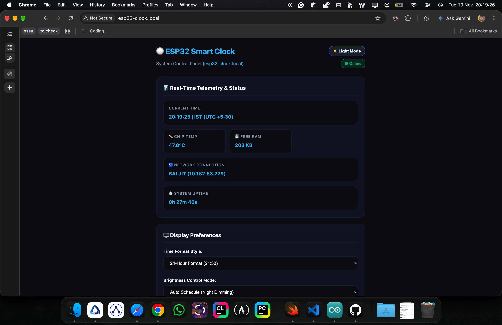
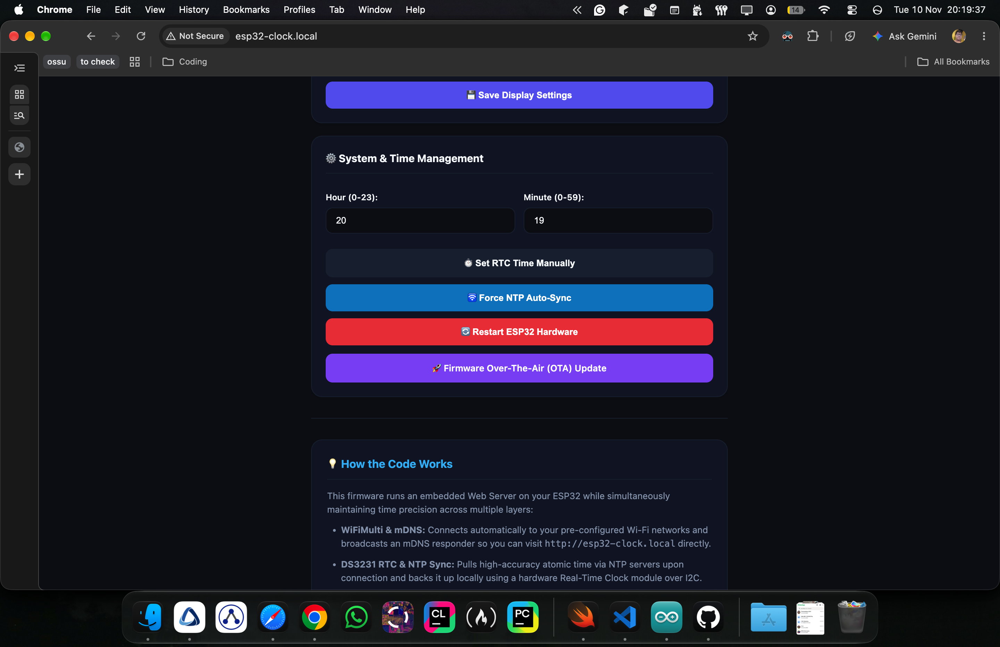
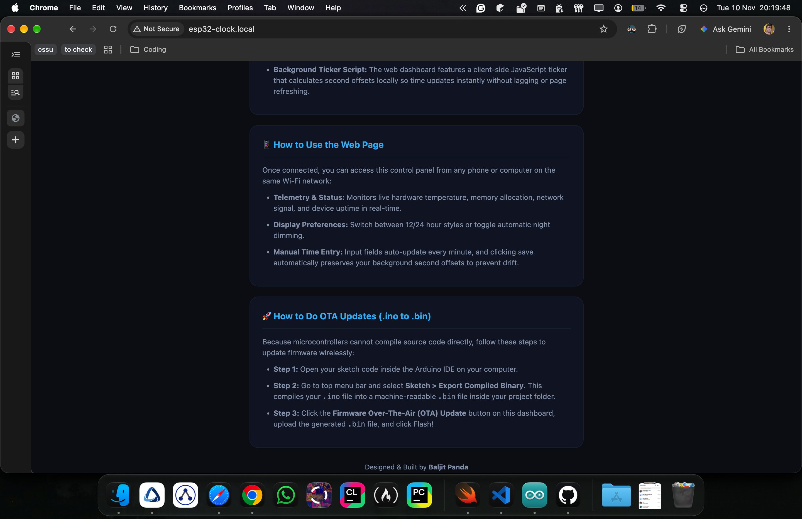

# 🕒 ESP32 Smart Clock

An advanced, feature-rich, mobile-responsive smart desk clock powered by an ESP32 microcontroller, featuring live NTP/RTC timekeeping, an embedded local web dashboard (`http://esp32-clock.local`), automatic night dimming, Wi-Fi multi-network failover, and wireless OTA firmware updates.

Designed & Built by [**Baljit Panda**](https://github.com/olympus-mons26).

---

## 🛠️ Required Components

1. **ESP32 Development Board** (ESP32-S / NodeMCU-32S)
2. **TM1637 4-Digit 7-Segment LED Display** (with colon)
3. **DS3231 Real-Time Clock (RTC) Module** (with backup coin cell battery)
4. **Onboard Status LED** (GPIO 2; in-built)
5. **Cables, breadboard, jumper (DuPont) wires** (for the connection)

---

## 🔌 Hardware Connections & Pinout

| Component / Pin  | ESP32 Pin / Rail | Description               |
| :--------------- | :--------------- | :------------------------ |
| **TM1637 `VCC`** | `5V` or `3.3V`   | Display Power Supply      |
| **TM1637 `GND`** | `GND`            | Display Ground            |
| **TM1637 `CLK`** | `GPIO 18`        | Display Clock Signal      |
| **TM1637 `DIO`** | `GPIO 19`        | Display Data Input/Output |
| **DS3231 `VCC`** | `3.3V` or `5V`   | RTC Power Supply          |
| **DS3231 `GND`** | `GND`            | RTC Ground                |
| **DS3231 `SDA`** | `GPIO 21`        | I2C Serial Data           |
| **DS3231 `SCL`** | `GPIO 22`        | I2C Serial Clock          |

---

## 📦 Arduino IDE Dependencies & Libraries

To compile and flash this firmware successfully, ensure your Arduino IDE has the **ESP32 Board Package** installed along with the following required libraries:

### 1. Board Package

- **ESP32 by Espressif Systems** (Install via _Tools > Board > Boards Manager_ by searching for "ESP32").

### 2. Required Third-Party Libraries

Install these via the Arduino IDE Library Manager (_Tools > Manage Libraries..._):

- **`TM1637Display`** (by Avishay Orpaz) – Controls the 4-digit 7-segment display module.
- **`RTCLib`** (by Adafruit) – Handles communication with the DS3231 Real-Time Clock over I2C.

## 💡 How It Works

- **Multi-SSID WiFiMulti:** Automatically scans and connects to whichever pre-configured Wi-Fi network (_can be more than one_) is in range.
- **mDNS Integration:** Broadcasts its hostname locally, allowing you to access the web panel instantly via `http://esp32-clock.local` without needing to look up its IP address (_works only when both the devices are on the same Wi-Fi network, for both the mDNS & localhost_).
- **Hybrid Time Synchronization:** Combines high-accuracy atomic time fetched from public NTP servers (`pool.ntp.org`) upon connection with a hardware DS3231 Real-Time Clock module over I2C for offline reliability.
- **Client-Side Second Interpolation:** The web dashboard features a JavaScript background ticker that keeps time moving smoothly down to the exact second without requiring constant page reloads or lagging.
- **Fixed IST Timezone:** Permanently locked to Indian Standard Time (IST / UTC +5:30).

---

## 📱 How to Use the Web Page

1. Connect your smartphone, tablet, or laptop to the same Wi-Fi network as your ESP32.
2. Open your web browser and type: **`http://esp32-clock.local`**
3. **Dashboard Features:**
   - **Real-Time Telemetry:** View live ESP32 core temperature, free RAM allocation, Wi-Fi signal/gateway info, and device uptime.
   - **Display Preferences:** Switch between 12-hour and 24-hour display formats or toggle automatic night dimming schedules.
   - **System Management:** Manually set RTC time, force an NTP auto-sync, remotely restart the hardware, or initiate a wireless firmware update.

---

## 🚀 How to Do OTA Updates (`.ino` to `.bin`)

Because microcontrollers cannot compile source code directly, wireless updates require a compiled binary:

1. Open your sketch inside the **Arduino IDE** on your computer.
2. Navigate to the top menu bar and select **Sketch > Export Compiled Binary**. This generates a machine-readable `.bin` file inside your project folder.
3. Open `http://esp32-clock.local` in your browser, click **Firmware Over-The-Air (OTA) Update**, select your exported `.bin` file, and click upload!

---

## Why was this made?

This was made by me for a _basic_ school project for the **Atal Tinkering Lab (ATL)**.

---

## 🔗 Project Repository

- [ESP32 Digital Clock Repository](https://github.com/olympus-mons26/esp32-digital-clock/)

---

---

## LICENSE 

MIT License

---

## Image(s)

### Image(s) of the webpage (`http://esp32-clock.local/`) on macOS

### Image(s) of the connections & hardware

`\\ TO DO`

## Images(s) of the webpage (`http://esp32-clock.local/`) on Android

`\\ TO DO`

---

## A few things to work on (TO REMOVE AFTER DONE)

1. Check if OTA updates works, and the webpage updates.
